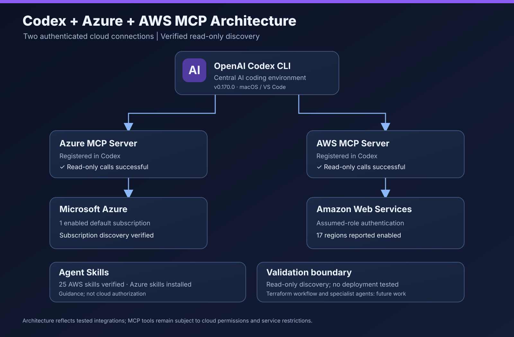
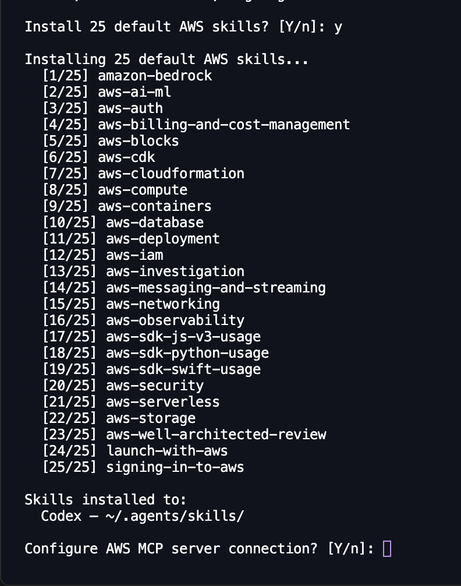
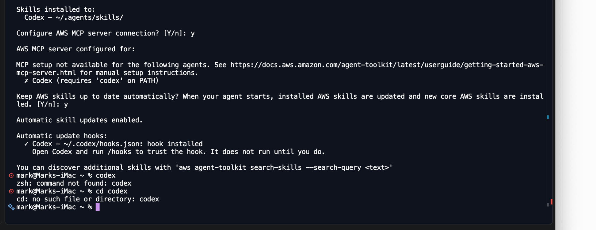
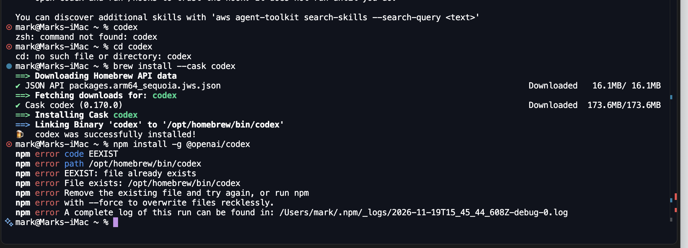
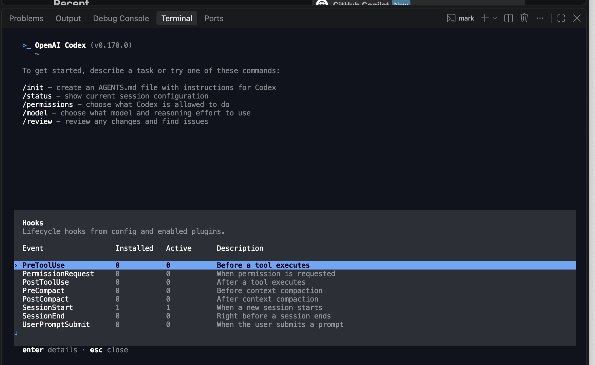
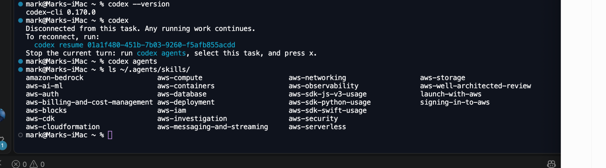

# Multi-Cloud MCP Integration with OpenAI Codex ☁️

**Azure + AWS | Model Context Protocol | AI-assisted cloud engineering**

## The problem
Cloud engineers often switch between separate consoles and command-line tools to investigate resources. This project explores a single AI-assisted interface for **read-only cloud discovery**, without claiming that the AI agent independently manages cloud infrastructure.

## What I built
- Installed OpenAI Codex CLI (verified as v0.170.0).
- Installed and verified **25 AWS agent skills**; installed Azure agent skills.
- Registered the **Azure MCP Server** and **AWS MCP Server** in Codex.
- Successfully queried both cloud environments using **read-only** requests.

## Verified results
| Provider | Validation | Outcome |
|---|---|---|
| Azure | Subscription discovery | 1 enabled default subscription |
| AWS | Account/role identity and EC2 region discovery | Assumed role identified; 17 regions reported enabled |
| Both | Authentication and permission errors in tested calls | None reported |

**Scope:** The AWS region listing does not establish EC2 deployment permissions in those regions. No create/update/delete operations were tested. The role name does not prove unrestricted access.

## Architecture
Codex → Azure MCP Server → Azure subscription discovery  
Codex → AWS MCP Server → AWS identity and region discovery

Azure and AWS skills provide instructions to the agent; MCP servers provide callable tools. These are distinct from the Terraform provider and cloud CLI.

## Engineering evidence: from installation to verified environment

The following screenshots document the **real setup and troubleshooting process**. Rather than treating screenshots as proof of capabilities they do not show, each image is paired with its observed engineering outcome.

### 01 · Installing the AWS Agent Skills

**Objective:** Make AWS-specific reference skills available to the Codex environment.

**What I did:** Installed the AWS agent skill collection using the terminal. The installation included 25 AWS-focused skills, covering areas such as IAM, networking, compute, and security.

**Why it matters:** Good AI-assisted cloud engineering begins with discoverable, domain-relevant tools and guidance, not just prompts.

*Evidence: AWS skill installation output. See also [full-size screenshot](screenshots/01-aws-skills-installed.png).*

---

### 02 · Troubleshooting the MCP Setup

**Objective:** Configure the AWS integration for Codex.

**Challenge:** During setup, the AWS tooling could not find the `codex` executable on the shell's `PATH`, preventing the intended Codex MCP configuration step from completing.

**Engineering response:** Identified the missing CLI prerequisite before continuing with MCP registration.

**What I learned:** An integration failure can originate in the local toolchain rather than in AWS authentication or cloud services.

*Evidence: setup output documenting the missing Codex executable. [View full size](screenshots/02-mcp-setup-troubleshooting.png).*

---

### 03 · Installing and Verifying Codex CLI

**Objective:** Resolve the local Codex executable dependency.

**What I did:** Installed Codex CLI through Homebrew, then checked its availability. An attempted npm installation produced an `EEXIST` conflict because a Codex executable was already present; the Homebrew-installed version was retained rather than forcibly overwritten.

**Why it matters:** Dependency management includes recognizing existing installations and avoiding unnecessary changes to a working environment.

*Evidence: Codex installation and duplicate-path diagnostic output. [View full size](screenshots/03-codex-cli-installation.png).*

---

### 04 · Inspecting the Codex SessionStart Hook

**Objective:** Understand the agent's local initialization environment.

**What I observed:** Codex reported one installed and active `SessionStart` hook.

**Engineering distinction:** This screenshot verifies the reported hook state; it does **not** demonstrate that multiple specialized agents or a complete agent orchestration workflow have been configured.

*Evidence: inspection of available Codex hooks. [View full size](screenshots/04-codex-hooks.png).*

---

### 05 · Verifying the Installed AWS Skill Environment

**Objective:** Confirm the installed tools could be found locally after troubleshooting.

**What I verified:** The Codex CLI was available, and the AWS skill directories were present in `~/.agents/skills/`. This complements the original installation log with a separate local verification step.

**Why it matters:** Successful installation messages should be followed by independent verification of the executable and expected files.

*Evidence: CLI version and local skill directories. [View full size](screenshots/05-aws-skills-verified.png).*

### Cloud MCP validation: reported results

After setup, Codex reported that **both MCP servers responded successfully to read-only calls**:

| Integration | Read-only check | Reported result |
|---|---|---|
| Microsoft Azure | Subscription discovery | One enabled default subscription |
| Amazon Web Services | Identity and EC2 region discovery | Assumed role recognized; 17 regions reported enabled |
| Both | Errors during these calls | No authentication or permission errors reported |

**Evidence boundary:** The five screenshots above show installation, local troubleshooting, and environment verification—not the final MCP calls themselves. A sanitized screenshot or transcript of successful Azure/AWS MCP discovery remains **to be added**. Region enumeration does not verify EC2 launch permissions, and no resource modification was tested.

## Reproduce the setup
See [installation guide](docs/installation-guide.md), [security considerations](docs/security-considerations.md), and [troubleshooting](docs/troubleshooting.md). The sample MCP configuration is **illustrative** and does not include credentials.

## Future improvements — not yet completed
- Terraform validation and approval-gated deployments
- Seven specialized Codex agents
- Automated MCP integration checks
- Sanitized screenshot of successful Azure/AWS MCP discovery

## Skills demonstrated
MCP integration · Cloud authentication · Multi-cloud discovery · CLI troubleshooting · Agent skill configuration · Security-conscious documentation

> This repository documents configuration and validation of existing MCP servers. It does **not** claim development of a custom MCP server.
